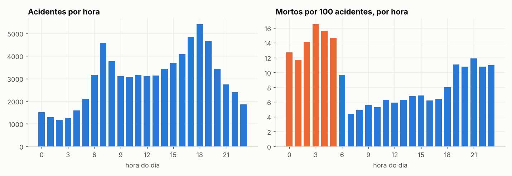
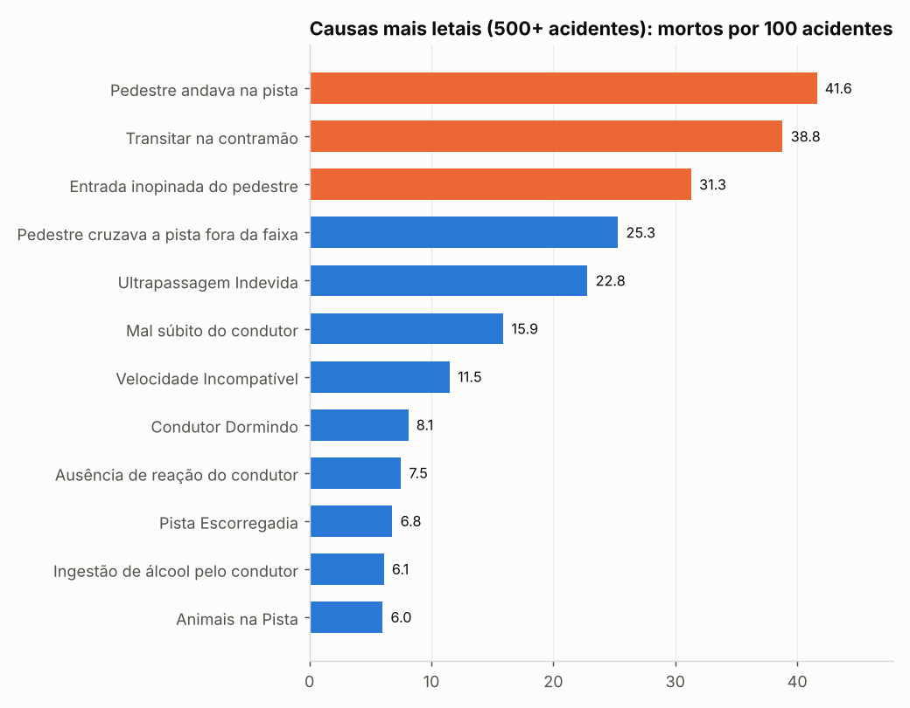

# Acidentes nas rodovias federais em 2025: quando, onde e por quê

Análise de ponta a ponta dos **72.529 acidentes** registrados pela Polícia Rodoviária Federal (PRF) em 2025, com limpeza dos dados, auditoria de qualidade, consultas em SQL, análise em Python e painel interativo.

**Autor:** Vinicius Katsuno | [LinkedIn](https://www.linkedin.com/in/viniciuskatsuno/)

## Perguntas

1. Em que momentos os acidentes são mais letais?
2. Onde estão concentrados acidentes e mortes?
3. Quais causas e tipos de acidente mais matam?

**Métrica principal:** mortos por 100 acidentes (letalidade). Ela permite comparar grupos de tamanhos diferentes.

## Principais achados

| Achado | Dado |
|---|---|
| Visão geral de 2025 | 72.529 acidentes, 6.043 mortos, 8,3 mortos por 100 acidentes |
| Madrugada é o horário mais letal | 16,5 mortos por 100 acidentes às 3h, contra 4,4 às 7h. O pico de volume é às 18h |
| Fim de semana é mais letal | 8,6% dos acidentes são fatais no sábado e domingo, contra 6,5% nos dias úteis (1,31x; qui-quadrado, p < 0,001) |
| Álcool pesa mais aos domingos | 10,4% dos acidentes de domingo, contra 2,3% a 3,6% de terça a sexta |
| Poucos tipos concentram as mortes | Colisão frontal e atropelamento de pedestre: 10,7% dos acidentes e 46,0% dos mortos |
| Estados diferem em letalidade | Bahia: 14,2 mortos por 100 acidentes. Santa Catarina: 5,3 |
| São Paulo | 4.683 acidentes, 221 mortos, 4,7 mortos por 100 acidentes |

Um resultado contraintuitivo: sob chuva a letalidade não é maior que em tempo bom, nem quando se separa por período do dia. A hipótese é velocidade menor na chuva, mas os dados não permitem confirmar.

## O que foi feito

| Etapa | Arquivo | O que faz |
|---|---|---|
| 1. Limpeza | `scripts/01_limpeza.py` | Corrige codificação, tipos, datas e nulos sem apagar linhas; registra cada decisão em `docs/log_limpeza.md` |
| 2. Banco | `scripts/02_carga_sqlite.py` | Carrega a base tratada em SQLite |
| 3. KPIs em SQL | `sql/kpis.sql` e `scripts/03_rodar_consultas.py` | 15 consultas com GROUP BY, CASE, CTE e funções de janela (RANK, LAG) |
| 4. Auditoria de qualidade | `scripts/04_auditoria_qualidade.py` | 19 testes automáticos (críticos, atenção, informativos); relatório em `docs/relatorio_qualidade.md` |
| 5. Análise | `notebooks/analise_acidentes_prf_2025.ipynb` | Gráficos, teste de hipótese e conclusões |
| 6. Painel web | `dashboard/painel_acidentes_prf_2025.html` | Painel interativo com filtros por estado e dia da semana |
| 7. Power BI | `powerbi/` | Medidas DAX e passo a passo para montar o painel |

### Problemas encontrados na base

Os principais, todos tratados ou sinalizados (detalhes em `docs/log_limpeza.md`):
- Arquivo em ISO-8859-1, com separador `;` e decimal com vírgula.
- `km` e datas como texto; data e horário em colunas separadas.
- 167 acidentes sem BR identificada; 1.000 com clima ignorado; 1 classificação nula.
- Em 3.823 linhas (5,3%), `pessoas` é menor que a soma das categorias. A investigação em `docs/relatorio_qualidade.md` mostra que a diferença só aparece quando o campo `ignorados` entra na soma e que todas essas linhas têm 2 ou mais veículos. A causa exata não é confirmada pela base, por isso as métricas usam `mortos` e `feridos`.

## Como reproduzir

1. Baixe o arquivo de acidentes agrupados por ocorrência de 2025 na página de [Dados Abertos da PRF](https://www.gov.br/prf/pt-br/acesso-a-informacao/dados-abertos/dados-abertos-da-prf) e salve como `dados/brutos/datatran2025.csv`.
2. Instale as dependências: `pip install -r requirements.txt`.
3. Rode `./executar_tudo.sh`.
4. Para o notebook: `jupyter lab notebooks/analise_acidentes_prf_2025.ipynb`.

Os dados brutos e a base tratada não estão versionados, porque são arquivos grandes e podem ser regenerados pelos scripts. Confira as condições de uso na página da PRF antes de redistribuí-los.

## Limitações

- **Sem dados de tráfego.** Não é possível dizer qual rodovia é "mais perigosa", só onde há mais acidentes e mortes.
- **Um único ano**, sem tendência histórica.
- Só acidentes registrados pela PRF em rodovias federais.
- Os recortes por hora, dia e clima mostram associação, não causa.
- As medidas DAX do Power BI não foram executadas no Power BI Desktop durante a montagem; confira-as ao criar o painel.

## Ferramentas

Python (pandas, SciPy, Matplotlib), SQL (SQLite), JavaScript (Chart.js) no painel web, Power BI (medidas DAX).
